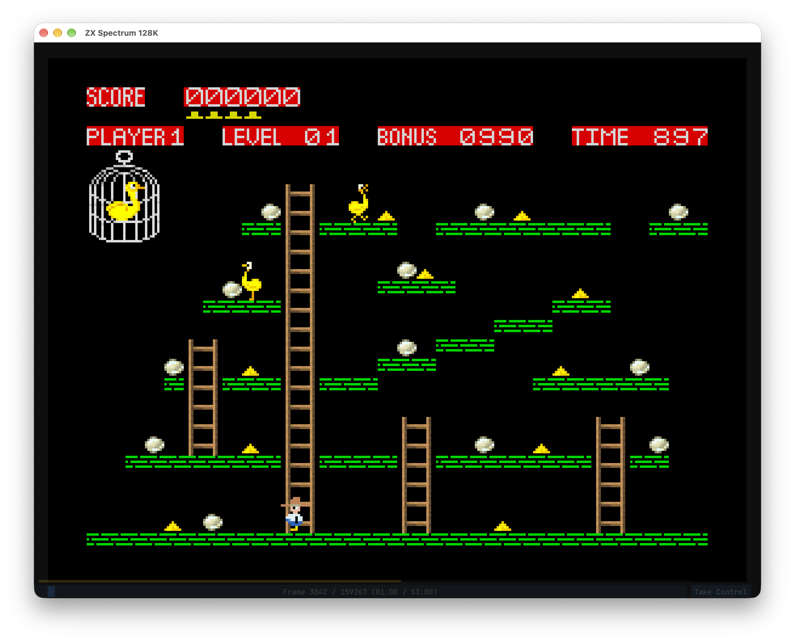
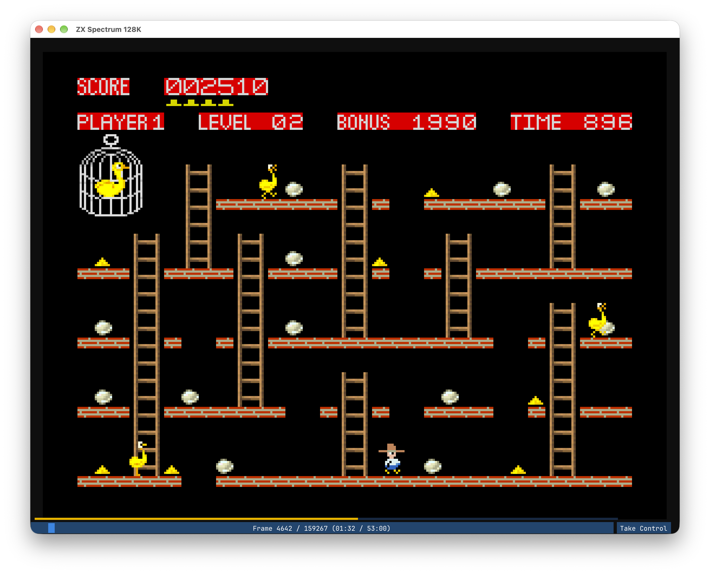
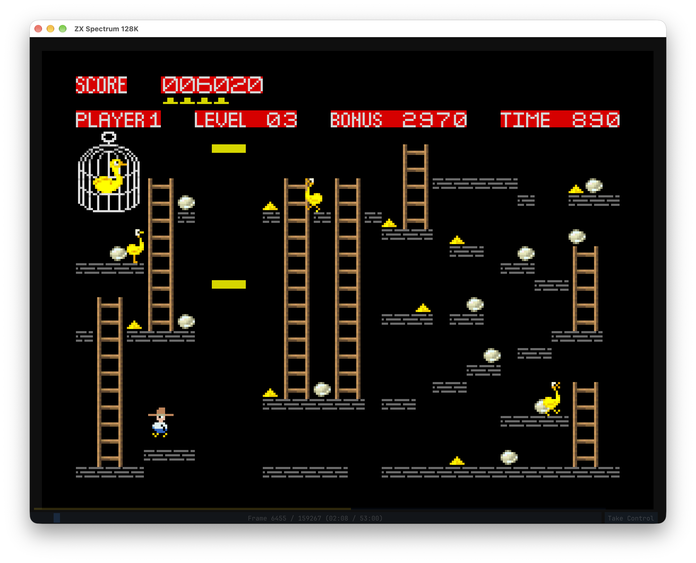
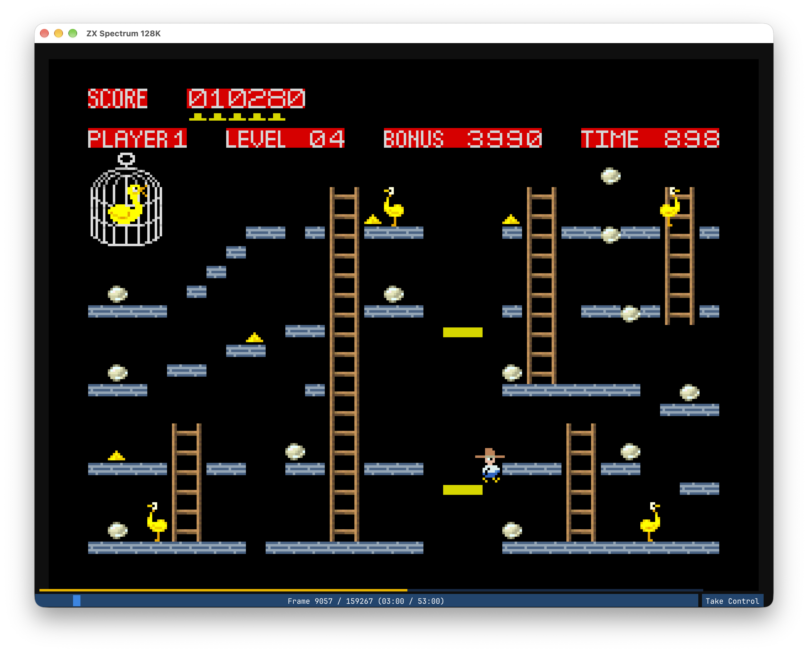
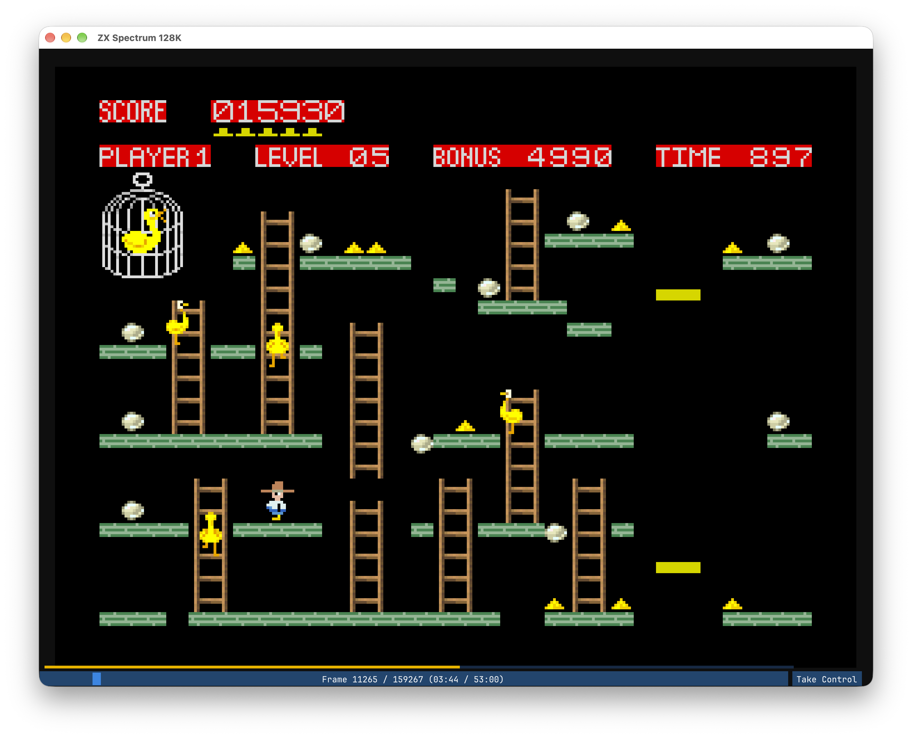
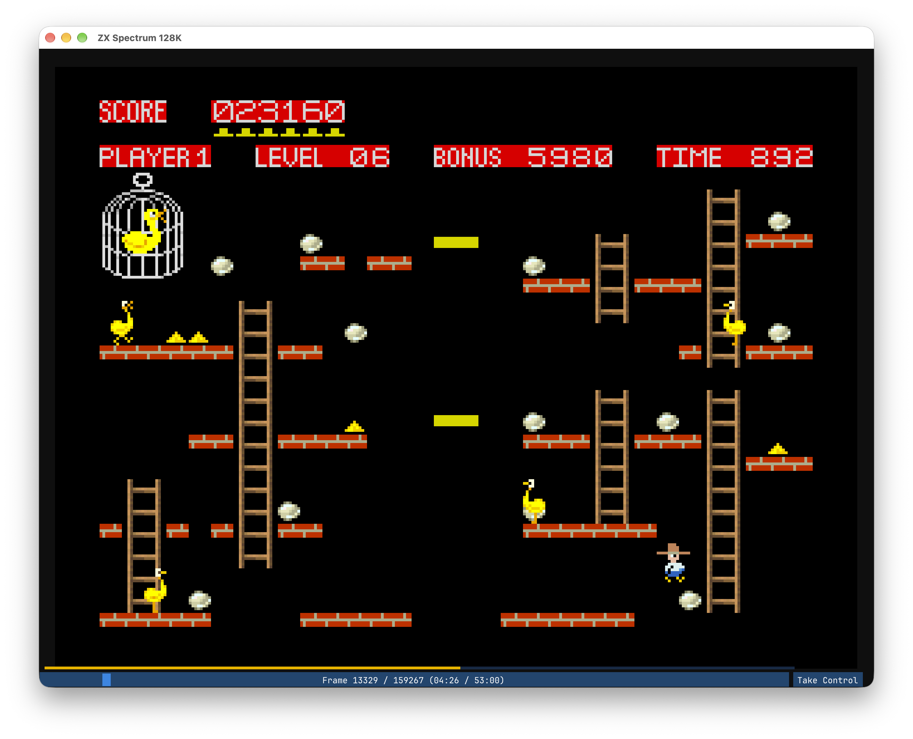
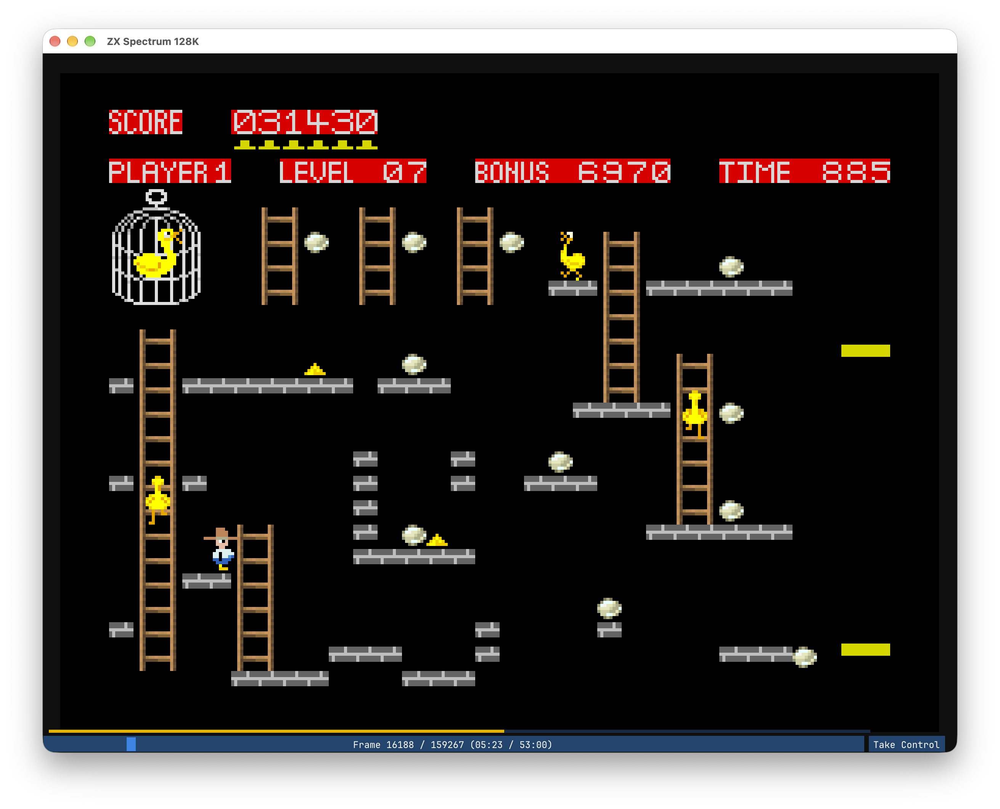
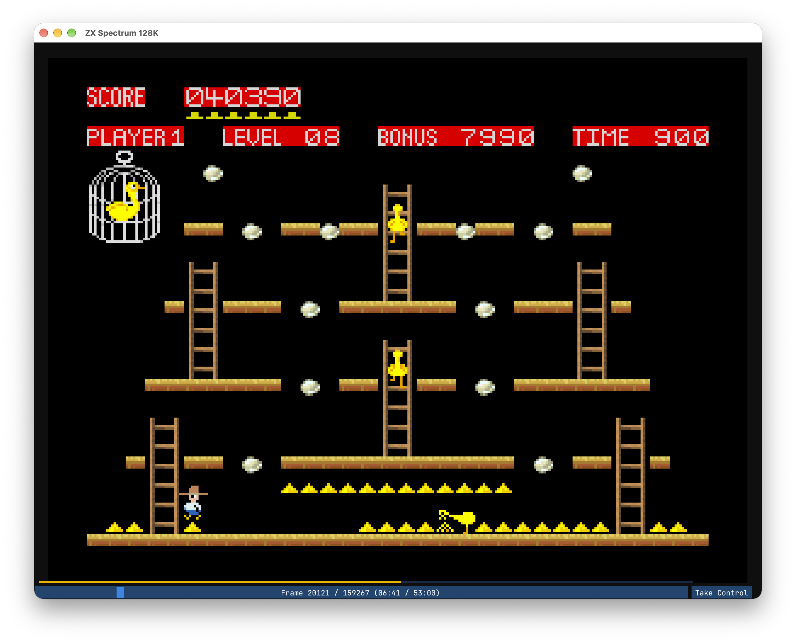

# Chuckie Egg (Enhanced)

An enhanced edition of A&F Software's *Chuckie Egg* for the ZX Spectrum custom **ULAX** driver (`.dux`).

- Initially based on a **Spec256** colours I found, then I improved the platform colours and ladder colours.
- The sprites colision drawing logic created very weird artifacts, so I changed the screen rendering logic
- Added some 128k AY music:
  - Der Ententanz (Werner Thomas): title screen tune, looping with a short pause.
  - Romance Anónimo (first 8 bars): death tune, plays while the game waits.
  - The Entertainer (Scott Joplin): gameplay tune; it starts on odd levels, then the rags alternate.
  - Maple Leaf Rag (Scott Joplin): gameplay tune; it starts on even levels, then the rags alternate.
  
  The gameplay tune plays alongside the beeper. I felt that the beeper is part of the game and didn't want to drop it. The AY music plays on the background.

## Enhancements

### ULAX Per-Pixel Colouring

- **Harry the farmer**: full per-pixel colouring across all walking and
  climbing frames, including a custom pale-blue shirt and yellow rain boots. Very small changes from the Spec256 version I found.
- **Hens & the Big Duck**: shaded yellow and gold sprites; the Big Duck keeps
  its colours independently of the cage. Copied from the Spec256.
- **Silver cage**: recoloured in greys rather than gold.
- **Items & scenery**: shaded eggs, filled two-tone yellow corn piles, and
  multi-tone wooden ladders.

### Per-Level Platform Styles (Levels 1–8)

Each level loads a different brick palette and pattern into the ULAX
translation register (`T`), giving levels 1–8 distinct platform styles (which
later levels repeat):

| Level | Style |
| :---: | ----- |
| 1 | Original ZX Spectrum platforms (plain ink/paper) |
| 2 | Spec256 red bricks with grey mortar |
| 3 | C64-inspired grey bricks on black mortar |
| 4 | Blue bricks and light blue mortar |
| 5 | MSX-inspired muted green bricks and pale mint mortar |
| 6 | Red bricks with an alternate row pattern (`a / a / fill / b / b`) |
| 7 | Dark and light grey bricks using the Level 6 row pattern |
| 8 | Remake-inspired straw-yellow, gold, and orange platforms |

### Engine & Audio Builds

- **Faster rendering**: updated sprite/tile drawing routines paired
  with matching ULAX point-machine commands.
- **48K, 128K, and tape releases**: includes 128K support with tunes as well as
  48K snapshot and `.tzx` tape builds.

### Extra 8 level loop

Chuckie Egg cycles through the same 8 level layouts in 8-level loops, varying the enemy setup on each pass:

The original game's level loops follow this logic:

- Levels 01-08: Hens (3 or 4 hens, depending on the level)
- Levels 09-16: Flying Duck
- Levels 17-24: Hens + Flying Duck
- Levels 25-32: Hens + Flying Duck + Extra Hens (5 hens now in total)
- Levels 33-40: Hens + Flying Duck + Extra Hens (faster)
- and then repeats

My extended version adds a new loop with hens * extra hens from level 17 to 24

- Levels 01-08: Hens
- Levels 09-16: Flying Duck
- Levels 17-24: Hens + Extra Hens
- Levels 25-32: Hens + Flying Duck
- Levels 33-40: Hens + Flying Duck + Extra Hens
- Levels 41-48: Hens + Flying Duck + Extra Hens (faster)
- and then repeats

## Files

- `Chuckie Egg.enhanced.48k.szx` / `Chuckie Egg.enhanced.48k.dux` – 48K ZX
  Spectrum snapshot and matching ULAX driver
- `Chuckie Egg.enhanced.128k.szx` / `Chuckie Egg.enhanced.128k.dux` – 128K ZX
  Spectrum snapshot and matching ULAX driver
- `Chuckie Egg.enhanced.tzx` – Enhanced `.tzx` tape image
  - on 128K includes AY tunes, on 48K just beeper.
- `Chuckie Egg.enhanced.128k.rzx` – 128K `.rzx` gameplay recording
- `Chuckie Egg.asm` – Annotated disassembly of the original game used as
  reference

## Screenshots

| Level 1 | Level 2 |
| :---: | :---: |
|  |  |

| Level 3 | Level 4 |
| :---: | :---: |
|  |  |

| Level 5 | Level 6 |
| :---: | :---: |
|  |  |

| Level 7 | Level 8 |
| :---: | :---: |
|  |  |
